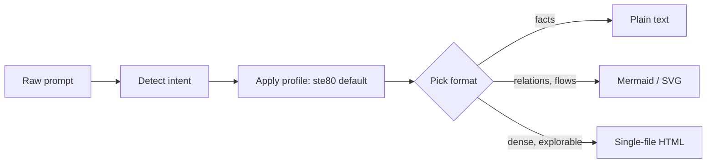

# ste-prompt-fixer

An agent skill that fixes sloppy prompts. It rewrites them in controlled-English style (ASD-STE100, ~80% strict) and picks the right output format: plain text, diagram, or single-file HTML.

Inspired by Andrej Karpathy's X post (Oct 2, 2026) on understanding LLM outputs.

Topics: `llm` `prompt-engineering` `claude-skills` `asd-ste100` `agents` `agent-skills` `mcp` `technical-writing` `turkish-llm`

## Why

Models write long, padded answers by default. Controlled languages fix that: short sentences, fixed vocabulary, no ambiguity. This skill wraps that idea so any agent that reads `SKILL.md` (Claude Code, Codex, Cursor, Amp, Copilot) can apply it.

Bonus: `lint/ste-lint.md` turns the same rules into a linter spec, and `tests/fixtures.md` provides seed prompts for regression tests.

## Install

Claude Code: copy `SKILL.md` to `~/.claude/skills/prompt-fixer/SKILL.md`.

Cursor: paste the body into `.cursor/rules/prompt-fixer.mdc`.

Any agent following the agentskills.io format: place the folder in its skills path.

## Structure

```
SKILL.md                 core flow: intent -> rewrite -> format
profiles/                style packs, one standard per file
  ste80.md               ASD-STE100, 80% strict (default)
  plain-english.md       public plain-language style
  globish.md             1500-word ceiling, non-native readers
  cte-style.md           procedure-first service manual style
  turkish.md             Turkish humanizer + STE hybrid
conventions/             context packs
  agents-md.md           align prompts with repo AGENTS.md rules
  llms-txt.md            suggest /llms.txt for site-targeted prompts
lint/
  ste-lint.md            linter-style rules + regex checks for LLM output
tests/
  fixtures.md            bad prompt -> fixed prompt seed set (goal: 50)
examples/
  before-after.md        one fixed prompt per profile
```

The model reads a profile file only when that profile is selected. Keeps context small.

## Format ladder



## Example

Input:

> you are a senior dev please explain microservices vs monolith thanks urgent

Output (ste80):

```
Describe microservices vs monolith.
Audience: a team choosing a stack for a new project.
Give one table, max 6 rows: latency, deploy speed, debugging, scaling, team size, cost.
End with a 3-sentence verdict: when to choose each.
Max 300 words.
```

## ste-lint quick check

```bash
grep -EIn "(worth noting|delve|tapestry|ever-evolving|in today's fast-paced world|game-changer)" docs/*.md && exit 1
```

## Credits

- Andrej Karpathy for the ASD-STE100 prompting idea
- ASD for the STE100 specification
- Caterpillar, IBM, GM for decades of controlled-language work

## License

MIT
